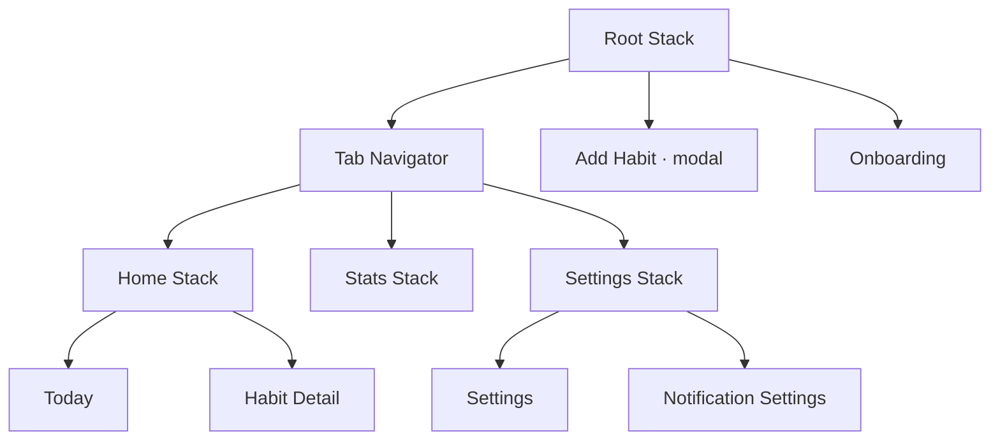

# 01 · Navigation Concepts: Stacks, Tabs & Modals

On the web, navigating usually means replacing one page with another. On a phone, navigation is
spatial: a new screen **slides over** the previous one, which is still there underneath, and the
back gesture slides it away again. Tabs keep several independent histories alive at once. Modals
rise from the bottom and are dismissed downward. Users have years of muscle memory for these
patterns, so getting them right is one of the biggest factors in whether an app "feels native."

This lesson is conceptual on purpose. Expo Router (next lesson) gives you the syntax; this lesson
gives you the model, which is the same whether you use Expo Router or React Navigation directly.

## The three navigators every app combines

### Stack

A **stack** is a history of screens. Pushing adds a screen on top; popping removes it.

```
push(Details 42)          push(Edit 42)            back()
[ List ]          →  [ List, Details 42 ]  →  [ List, Details 42, Edit 42 ]  →  [ List, Details 42 ]
```

Crucially, **screens underneath stay mounted**. When you go back from Details to List, List doesn't
re-render from scratch or re-fetch; its scroll position and state are exactly as you left them.
That's very different from web routing, where the previous page usually unmounts.

Stack transitions are platform-specific: iOS slides from the right with an interactive edge-swipe
back gesture; Android uses its own system animations and the system back button or gesture.

### Tabs

A **tab navigator** shows a bar of top-level destinations. Each tab typically contains its **own
stack**, so if you drill into Settings → Notifications, switch to Home, and come back, you're still
on Notifications. Tabs are also lazily mounted by default (a tab renders the first time you visit
it) and stay mounted afterwards.

### Modal

A **modal** is a screen presented over everything else, for a self-contained task: compose a
message, add an item, a filter sheet. It's dismissed rather than navigated "back" from. On iOS,
modals are usually presented as sheets that can be swiped down.

## Combining them: the navigation tree

Real apps nest navigators. A typical structure:



Design rules that fall out of this:

- **Modals live in the root stack**, above the tabs, so they cover the tab bar.
- **Detail screens live inside a tab's stack** if the tab bar should stay visible, or in the root
  stack if they should cover it (for example, a full-screen photo viewer).
- **Authentication flows are siblings of the tabs**, not children: a signed-out user should not be
  able to "go back" into the app.

## Navigation state

A navigator's current situation is a plain object — the **navigation state**:

```ts
// Simplified shape of a navigation state
type NavState = {
  type: 'stack' | 'tab';
  index: number;                  // which route is focused
  routes: Array<{
    key: string;                  // unique per instance, e.g. "habit-detail-x7Fq"
    name: string;                 // the route/screen name, e.g. "habits/[id]"
    params?: Record<string, string>;
    state?: NavState;             // nested navigator's state
  }>;
};
```

Pushing `Details 42` twice gives **two routes with the same name and different keys** — two
mounted instances. Reasoning about navigation as "what does the state object look like after this
action?" makes most navigation bugs obvious.

## Native screens vs JavaScript screens

There are two broad ways to implement a stack:

| | Native stack | JS stack |
|---|---|---|
| Built on | Platform navigation controllers via `react-native-screens` (`UINavigationController`-style on iOS, fragments on Android) | Views animated by JavaScript/Reanimated |
| Feel | Exactly native transitions, headers, large titles, gestures | Close to native; fully customisable animations |
| Performance | Transitions run natively, unaffected by a busy JS thread | Good, but more work in JS |
| Customisation | Limited to what the platform offers | Anything |

Expo Router's default `Stack` is a **native stack**. Use it unless you need a transition the
platform can't do.

## Lifecycle: focus, not mount

Because screens stay mounted, `useEffect(() => {...}, [])` runs **once** when a screen first
mounts — not every time the user comes back to it. If you need "every time this screen is shown"
(refresh a count, restart a camera, track a screen view), use focus events:

```tsx
import { useCallback } from 'react';
import { useFocusEffect } from 'expo-router';

function TodayScreen() {
  useFocusEffect(
    useCallback(() => {
      console.log('Today is focused');
      return () => console.log('Today lost focus');
    }, []),
  );
  // ...
}
```

`useFocusEffect` runs its effect when the screen gains focus and its cleanup when it loses focus
(another screen pushed on top, tab switched, app navigated away).

## How It Actually Works

A navigator is a React component that owns a navigation state object and a **router** — a pure
function `(state, action) => newState`, very much like a reducer. `navigate`, `push`, `goBack` and
`replace` dispatch actions to the nearest navigator that can handle them; if it can't (for
example, `goBack` at the root of a tab's stack), the action bubbles to the parent navigator.

The navigator then renders **one child per route** in its state, which is why every screen in a
stack stays mounted. A native stack passes those children to `react-native-screens`, which wraps
each in a native screen container. The platform's navigation controller handles the transition,
the header and the swipe-back gesture on the UI thread; when the gesture completes, native tells
JavaScript, and the router removes that route from state. Off-screen screens can be **detached**
from the native view hierarchy (and "frozen" from re-rendering) to save memory, while their React
state is kept.

Tabs work the same way, with a tab router whose actions are "jump to tab N" instead of push and pop.

## Common mistakes

- **Fetching in `useEffect([])` and expecting it to re-run on return** — use `useFocusEffect` or a
  query library with refetch-on-focus.
- **Putting modals inside a tab's stack** — they render under the tab bar.
- **Making Login a screen in the same stack as Home** — the back gesture takes the user to the
  login screen after signing in. Use separate branches and replace, not push.
- **Pushing the same screen repeatedly** (a "Next" button that pushes Details again and again) —
  each one stays mounted and memory grows. Use `replace` or set params on the current screen.
- **Treating navigation as URL changes only** — mobile users expect gesture-driven back and
  preserved state.

## Exercise

Sketch (on paper or in a Mermaid diagram) the navigation tree for an app you use daily — a banking
app, a chat app or a music app. Mark each navigator as stack, tabs or modal; mark which screens hide
the tab bar; and mark where authentication sits. Then write the navigation state object (like the
`NavState` example) for one specific moment: "user is on tab 2, has drilled two screens deep, and has
a modal open."
