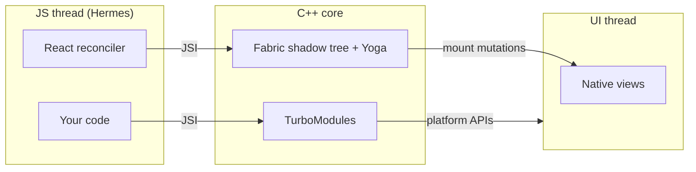

# 01 · Under the Hood: Threads, JSI & the New Architecture

You can build a lot without knowing how React Native runs. But the moment something stutters, a
native library won't install, or an animation drops frames only on cheap Android phones, you need
the model. This lesson explains the runtime as it works today — the **New Architecture** — and why it
replaced the original design. Every other lesson in Level 3 builds on it.

## Three kinds of threads

| Thread | Runs | If it's blocked… |
|--------|------|------------------|
| **JS thread** | Hermes executing your bundle: React rendering, hooks, event handlers, timers, `fetch` callbacks | Taps get no JS response; JS-driven animations freeze; state doesn't update |
| **UI / main thread** | Native view creation and mutation, touch delivery, native scrolling, native animations, the platform's rendering | Everything visibly freezes; the OS may report "App Not Responding" on Android |
| **Background threads** | Yoga layout in Fabric, image decoding, network I/O, native module work dispatched off-main | Usually invisible unless you wait on the result |

Phones refresh the screen 60 times a second or more (many recent phones run at 90 or 120 Hz), which
leaves about **16.7 ms per frame** at 60 Hz — less at higher refresh rates. Work that misses that
budget on the thread responsible for a frame shows up as a dropped frame: **jank**.

The key insight: **the JS thread and the UI thread are independent**. A native `ScrollView` keeps
scrolling smoothly while your JavaScript is busy, because scrolling never needs JavaScript. But a
`Pressable`'s `onPress`, a `useState` update, or an animation driven from JavaScript all wait for the
JS thread.

## The old architecture: the bridge

Until the New Architecture became the default (React Native 0.76, late 2024), JavaScript and native
code communicated through **the bridge**:

1. JavaScript wanted to update a view or call a native module.
2. The call was **serialised to JSON** and placed in a queue.
3. The queue was flushed **asynchronously** to the native side, which deserialised it and acted.
4. Results and events came back the same way.

Consequences you could feel: every interaction had serialisation overhead; nothing could be
**synchronous** (you couldn't measure a view and get the answer in the same tick); large data
(images, sensor streams) was expensive to pass; and all native modules were initialised at startup,
used or not, slowing launch.

## The New Architecture

The New Architecture has three main pieces, plus a code generator.

### JSI — the JavaScript Interface

JSI is a C++ API that lets the JavaScript engine and C++ code hold **direct references** to each
other. C++ can expose a "host object" to JavaScript, and when JavaScript calls a method on it, it's a
direct function call — no JSON, no queue. Calls can be synchronous when that makes sense, and they
can pass references to native memory rather than copying data.

JSI is engine-agnostic (it works with Hermes and with JavaScriptCore), and it's the foundation the
other pieces are built on.

### Fabric — the renderer

Fabric is the rendering system. In C++ it maintains an immutable **shadow tree** mirroring your
host components, runs Yoga layout on it, diffs it against the previous tree, and applies mutations to
native views on the UI thread. Because it's C++ shared across platforms and accessed via JSI, it can:

- Lay out synchronously when needed (for example, `measure` inside `useLayoutEffect` gets a real
  answer before paint).
- Support React's **concurrent features** — transitions, Suspense — because it can prepare several
  versions of the tree and commit the right one.
- Render work on multiple threads safely, since shadow trees are immutable once committed.

### TurboModules — native modules

TurboModules are the new native module system. They're **lazily loaded** (initialised the first time
JavaScript uses them, not at startup) and called through JSI, so calls are fast and can be
synchronous. Expo's own modules are built with the **Expo Modules API** (lesson 8), which also uses
JSI under the hood.

### Codegen

Native modules and components declare their interface in **typed JavaScript/TypeScript specs**.
**Codegen** reads those specs at build time and generates the C++ glue, so the JavaScript and native
sides agree on types — a mismatch becomes a build error instead of a runtime crash.



!!! note "Is the old architecture still around?"
    The New Architecture became the default in React Native 0.76, and recent releases removed the
    option to switch back to the legacy architecture. Libraries that only supported the old
    architecture worked for a while through an interop layer, but you should prefer libraries that
    declare New Architecture support. The [React Native Directory](https://reactnative.directory/)
    lets you filter libraries by that.

## Worked example: seeing the threads

You can observe the thread split directly. Add this screen to any project and run it on a device:

```tsx title="app/threads.tsx"
import { useState } from 'react';
import { Button, ScrollView, Text, View } from 'react-native';

function blockJsThread(ms: number) {
  const end = Date.now() + ms;
  while (Date.now() < end) {
    // busy-wait: deliberately freezes the JS thread
  }
}

export default function Threads() {
  const [count, setCount] = useState(0);
  return (
    <View style={{ flex: 1, padding: 16, gap: 12 }}>
      <Text style={{ fontSize: 18 }}>Taps registered: {count}</Text>
      <Button title="Tap me" onPress={() => setCount((c) => c + 1)} />
      <Button title="Block JS for 3 seconds" onPress={() => blockJsThread(3000)} />
      <ScrollView style={{ flex: 1, borderWidth: 1, borderColor: '#cbd5e1' }}>
        {Array.from({ length: 60 }, (_, i) => (
          <Text key={i} style={{ padding: 12 }}>Row {i + 1} — try scrolling while JS is blocked</Text>
        ))}
      </ScrollView>
    </View>
  );
}
```

Press "Block JS for 3 seconds", then immediately try two things:

1. **Scroll the list.** It scrolls — native scrolling runs on the UI thread.
2. **Tap "Tap me" several times.** The counter doesn't change until the three seconds are over,
   then catches up with the taps that were queued — `onPress` needs the JS thread.

Open the performance monitor from the dev menu while you do this: the **JS** frame rate drops to zero
during the block while the **UI** frame rate stays up. (You'll see your own device's numbers; this
lesson doesn't quote any.)

This is the whole case for Level 3's next lessons: put animation and gesture work where the UI
thread can do it without waiting for JavaScript.

## How It Actually Works

When your component renders `<View style={{ opacity: 0.5 }} />`, React (running on the JS thread)
calls Fabric's C++ `createNode`/`cloneNode` functions **through JSI** — directly, not via a message
queue. Fabric builds a new immutable shadow tree, runs Yoga, and diffs it against the currently
mounted tree. The resulting list of mount instructions ("create view 42", "update props on 17") is
then executed on the UI thread, which owns all native views.

When you call `Location.getCurrentPositionAsync()`, the Expo module's JavaScript object is a JSI host
object. The call goes straight into native code, which starts the platform's location request on an
appropriate thread and returns a promise; when the OS answers, the native side resolves the promise
on the JS thread. No JSON encoding of the call or the result was needed.

## Common mistakes

- **Doing heavy synchronous work in event handlers or renders** (sorting 50,000 items, parsing large
  JSON) — the JS thread blocks and taps stop responding.
- **Assuming "slow" means "the bridge"** in a modern app — there's no bridge. Profile instead
  (Level 4, lesson 1).
- **Installing libraries without checking New Architecture support.**
- **Confusing JS FPS with UI FPS** in the performance monitor — they describe different threads.

## Exercise

1. Run the threads screen on a physical device and note what happens to each control while JS is
   blocked.
2. Replace the busy-wait with `await new Promise((r) => setTimeout(r, 3000))`. Is the JS thread
   still blocked? Explain the difference in one sentence.
3. Find one library you use (or want to use) on the React Native Directory and check whether it
   supports the New Architecture and Expo. Write down what you'd do if it didn't.
