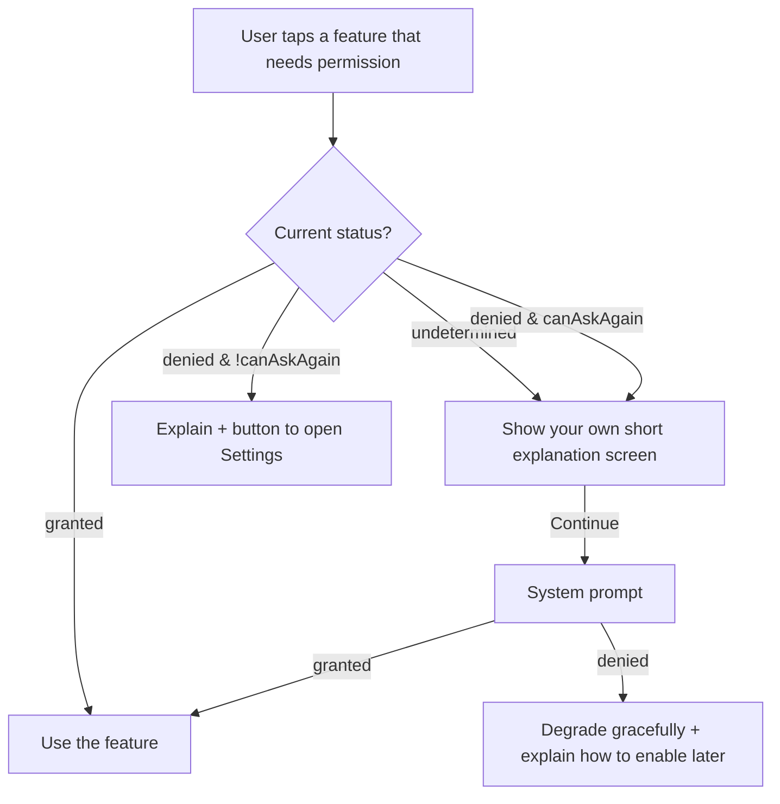

# 03 · Permissions Done Right

Permissions are the moment your app asks the user for trust. Ask at the wrong time ("Allow
notifications?" on first launch, before they know what the app does) and many users tap "Don't
Allow" — and on iOS you usually only get **one** system prompt per permission. After that, the only
way back is the user going into Settings. Good permission handling is therefore mostly product
design, with a little code.

## The rules of the platforms

- **iOS:** each permission's system prompt is shown at most once. If the user denies, later
  requests return `denied` immediately without showing anything. Every permission requires a
  **usage description string** in `Info.plist` explaining why; App Review rejects vague ones, and an
  app that requests a permission without its string crashes.
- **Android:** "dangerous" permissions are requested at runtime. If the user denies twice, the
  system stops showing the dialog (equivalent to "don't ask again"). Some permissions are requested
  differently by version — for example, notifications only became a runtime permission in Android 13
  (API level 33).
- **Both:** users can change any permission in Settings at any time, including while your app is in
  the background. Never cache "granted" forever; check when you need it.

## The permission response

Expo modules return a consistent shape:

```ts
type PermissionResponse = {
  status: 'granted' | 'denied' | 'undetermined';
  granted: boolean;
  canAskAgain: boolean;   // false → the system won't show a prompt again; send the user to Settings
  expires: 'never' | number;
};
```

Some permissions add detail. Location's response includes whether the user granted precise or
approximate location, and the photo library can be granted with **limited** access (only photos
the user selected). Handle the partial cases instead of treating them as denial.

## Configure usage strings in app.json

With Expo, permission strings are set through each module's config plugin and written into the
native projects at build time:

```json title="app.json (excerpt)"
{
  "expo": {
    "plugins": [
      ["expo-camera", { "cameraPermission": "Field Notes uses the camera so you can attach a photo to a note." }],
      ["expo-location", { "locationWhenInUsePermission": "Field Notes tags each note with where you wrote it." }]
    ]
  }
}
```

Write strings that say **what the user gets**, specifically. "This app needs camera access" is the
kind of string App Review flags; "Attach a photo to a note" is not. In Expo Go, Expo Go's own strings
are shown instead — you'll only see yours in a development or production build.

## The pattern: explain, then ask, then handle all three outcomes



Key points:

1. **Ask in context** — when the user taps "Attach photo", not on app launch.
2. **Pre-prompt** with your own UI first. If the user says "Not now" to *your* screen, you haven't
   spent the one-time system prompt.
3. **Degrade gracefully** — a note without a photo is still a note. Never block the whole app
   because one permission was denied (unless the app genuinely can't function — a camera app without
   camera access).
4. **Offer Settings** when `canAskAgain` is false: `Linking.openSettings()` opens your app's page in
   the system settings.

## Worked example: a reusable permission gate

```tsx title="src/usePermissionGate.ts"
import { useCallback, useEffect, useState } from 'react';
import { AppState, Linking } from 'react-native';

export type PermissionLike = { granted: boolean; canAskAgain: boolean; status: 'granted' | 'denied' | 'undetermined' };

type State = 'unknown' | 'granted' | 'can-ask' | 'blocked';

export function toGateState(p: PermissionLike | null): State {
  if (!p) return 'unknown';
  if (p.granted) return 'granted';
  return p.canAskAgain ? 'can-ask' : 'blocked';
}

/** Wraps any Expo-style get/request pair and re-checks when the app returns from Settings. */
export function usePermissionGate(get: () => Promise<PermissionLike>, request: () => Promise<PermissionLike>) {
  const [state, setState] = useState<State>('unknown');

  const refresh = useCallback(async () => setState(toGateState(await get())), [get]);

  useEffect(() => {
    refresh();
    const sub = AppState.addEventListener('change', (s) => { if (s === 'active') refresh(); });
    return () => sub.remove();
  }, [refresh]);

  const ask = useCallback(async () => {
    const result = await request();
    setState(toGateState(result));
    return result.granted;
  }, [request]);

  return { state, ask, openSettings: () => Linking.openSettings() };
}
```

```tsx title="src/LocationGate.tsx"
import { ReactNode } from 'react';
import { Button, Text, View } from 'react-native';
import * as Location from 'expo-location';
import { usePermissionGate } from './usePermissionGate';

const get = () => Location.getForegroundPermissionsAsync();
const request = () => Location.requestForegroundPermissionsAsync();

export function LocationGate({ children }: { children: ReactNode }) {
  const { state, ask, openSettings } = usePermissionGate(get, request);

  if (state === 'unknown') return null;
  if (state === 'granted') return <>{children}</>;

  return (
    <View style={{ padding: 24, gap: 12 }}>
      <Text style={{ fontSize: 18, fontWeight: '700' }}>Tag notes with a location?</Text>
      <Text style={{ fontSize: 16, color: '#475569' }}>
        We'll add the place you wrote each note, so you can find it on a map later. Your location is
        only read when you save a note, and never leaves your phone unless you sync.
      </Text>
      {state === 'can-ask' ? (
        <Button title="Continue" onPress={ask} />
      ) : (
        <>
          <Text style={{ color: '#475569' }}>Location is turned off for Field Notes in Settings.</Text>
          <Button title="Open Settings" onPress={openSettings} />
        </>
      )}
    </View>
  );
}
```

`get` and `request` are defined at module scope so they're stable references — otherwise the hook's
`useEffect` would re-run on every render. The `AppState` listener matters: when a user taps "Open
Settings", enables location and comes back, the gate updates on its own.

The mapping logic is a pure function, so it's covered by a quick test (run with Jest and passing in
the course's check project):

```ts title="src/usePermissionGate.test.ts"
import { toGateState } from './usePermissionGate';

test('maps permission responses to gate states', () => {
  expect(toGateState(null)).toBe('unknown');
  expect(toGateState({ granted: true, canAskAgain: true, status: 'granted' })).toBe('granted');
  expect(toGateState({ granted: false, canAskAgain: true, status: 'undetermined' })).toBe('can-ask');
  expect(toGateState({ granted: false, canAskAgain: false, status: 'denied' })).toBe('blocked');
});
```

## Asking for the least

- Ask for **foreground** location before ever considering background. Most features need only
  "while using the app".
- Prefer **approximate** location if precision isn't needed; users are more likely to say yes.
- Use the **system photo picker** (`expo-image-picker`'s `launchImageLibraryAsync`) to let users
  choose a photo — on modern iOS and Android the picker runs out of process and doesn't need full
  library permission at all.
- Don't request a permission just because a library *can* use it.

## How It Actually Works

Permissions are enforced by the operating system, not by React Native. On iOS, `TCC` (Transparency,
Consent and Control) tracks each app's decisions; when native code first calls, say,
`AVCaptureDevice.requestAccess(for: .video)`, the OS shows the prompt using the `NSCameraUsageDescription`
string from your `Info.plist`, records the answer, and from then on answers future requests silently.
That's why the Expo config plugin's job — writing that key at prebuild time — is essential: the string
must be in the compiled app, and a missing one terminates the app when the API is touched.

On Android, permissions are declared in `AndroidManifest.xml` (Expo modules add their own entries
during prebuild) and requested at runtime through `ActivityCompat.requestPermissions`, which shows
the system dialog and delivers the result back to the activity. Android derives `canAskAgain` from
`shouldShowRequestPermissionRationale` and the recorded state. Expo's modules wrap both systems in
the same `{ status, granted, canAskAgain }` shape.

## Common mistakes

- **Asking for everything on first launch.**
- **Not checking before asking** — calling `request…` every time you open a screen, even when it's
  already blocked.
- **Dead ends** — a denied permission with no explanation and no Settings button.
- **Missing or vague usage strings** — crashes or App Review rejection.
- **Caching `granted` in storage** — the user can revoke it in Settings.
- **Treating limited/approximate grants as failures.**

## Exercise

1. Build a `CameraGate` using `usePermissionGate` with `Camera.getCameraPermissionsAsync` and
   `Camera.requestCameraPermissionsAsync` from `expo-camera`.
2. On a device or simulator with a development build: deny camera permission, confirm the "Open
   Settings" path works, enable it in Settings, return to the app and confirm the gate updates without
   a restart.
3. Audit an app you use: when does it ask for notifications? Write a better moment and a better
   pre-prompt sentence.
4. Write `cameraPermission` and `locationWhenInUsePermission` strings for your own app idea that
   would survive App Review.
