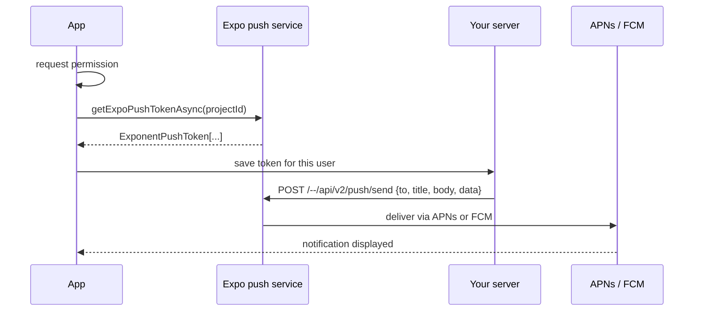

# 04 · Local & Push Notifications

Notifications are the one way your app can reach a user who isn't using it — which makes them both
valuable and easy to abuse. There are two kinds:

- **Local notifications** are scheduled **on the device** by your app: "Time to log your habits" at
  8 pm every day. No server needed, and they work offline.
- **Push notifications** are sent **from a server** through Apple's (APNs) or Google's (FCM) push
  service to the device: "Priya liked your recipe."

`expo-notifications` handles both with one API.

```bash
npx expo install expo-notifications expo-device expo-constants
```

!!! warning "Where you can test what"
    Local notifications can be tried in Expo Go and on simulators. **Remote push** needs a physical
    device and — in recent Expo SDKs — a development build rather than Expo Go (Expo removed remote
    push support from Expo Go on Android). iOS push additionally requires an Apple Developer account
    for the APNs credentials. This lesson's push sections are therefore a faithful walkthrough you run
    on your own device and accounts; no push delivery output is shown here.

## Foreground behaviour and permission

By default, notifications that arrive **while your app is open** are not shown. Decide once, at
startup, what should happen:

```ts title="src/notifications.ts"
import * as Notifications from 'expo-notifications';
import { Platform } from 'react-native';

Notifications.setNotificationHandler({
  handleNotification: async () => ({
    shouldShowBanner: true,   // show it even if the app is in the foreground
    shouldShowList: true,     // keep it in Notification Center / the shade
    shouldPlaySound: false,
    shouldSetBadge: false,
  }),
});

export async function ensureNotificationPermission(): Promise<boolean> {
  if (Platform.OS === 'android') {
    // Channels must exist before Android 13+ will show the permission prompt.
    await Notifications.setNotificationChannelAsync('reminders', {
      name: 'Habit reminders',
      importance: Notifications.AndroidImportance.DEFAULT,
    });
  }
  const current = await Notifications.getPermissionsAsync();
  if (current.granted) return true;
  if (!current.canAskAgain) return false;
  const asked = await Notifications.requestPermissionsAsync();
  return asked.granted;
}
```

Apply the previous lesson's rules: ask when the user turns on a reminder, not at launch.

**Android channels** group notifications so users can control them separately in system settings
(mute "Promotions", keep "Reminders"). Since Android 8, every notification must belong to a channel,
and its importance is fixed after creation — the user, not your code, changes it afterwards.

## Scheduling local reminders

```ts
import * as Notifications from 'expo-notifications';

export async function scheduleDailyReminder(hour: number, minute: number): Promise<string> {
  return Notifications.scheduleNotificationAsync({
    content: {
      title: 'Habit check-in',
      body: 'Two minutes to log today keeps your streaks honest.',
      data: { url: '/' },                         // where a tap should take the user
    },
    trigger: {
      type: Notifications.SchedulableTriggerInputTypes.DAILY,
      hour,
      minute,
      channelId: 'reminders',
    },
  });
}

await Notifications.cancelScheduledNotificationAsync(id);   // turn one off
await Notifications.cancelAllScheduledNotificationsAsync(); // or everything
const pending = await Notifications.getAllScheduledNotificationsAsync();
```

Other trigger types include `TIME_INTERVAL` (`seconds`, optionally `repeats`), `DATE` (a specific
moment), `WEEKLY` (`weekday`, `hour`, `minute`) and `CALENDAR`. Store the returned identifier so you
can cancel or replace the reminder when the user changes the time — scheduling again without
cancelling creates duplicates.

Platforms limit how many pending local notifications an app can have (iOS keeps the soonest 64), so
schedule repeating triggers rather than one notification per future day.

## Handling taps

When the user taps a notification, route them to the right screen — whether the app was in the
foreground, the background, or not running at all:

```tsx title="src/useNotificationRouting.ts"
import { useEffect } from 'react';
import * as Notifications from 'expo-notifications';
import { router } from 'expo-router';

function urlFrom(n: Notifications.Notification): string | null {
  const url = n.request.content.data?.url;
  return typeof url === 'string' && url.startsWith('/') ? url : null;
}

export function useNotificationRouting() {
  const last = Notifications.useLastNotificationResponse(); // includes the tap that launched the app

  useEffect(() => {
    if (!last) return;
    const url = urlFrom(last.notification);
    if (url) router.push(url as never);
  }, [last]);
}
```

Call `useNotificationRouting()` in your root layout. Validating `url` (only internal paths) matters:
push payloads come from a server, and you don't want a payload to be able to send users anywhere.
Typed routes (Level 2) don't know about runtime strings, hence the cast; validate before casting.

## Push notifications

The flow:



Getting a token in the app:

```ts
import * as Device from 'expo-device';
import Constants from 'expo-constants';
import * as Notifications from 'expo-notifications';

export async function registerForPush(): Promise<string | null> {
  if (!Device.isDevice) return null;                    // simulators can't receive remote push
  if (!(await ensureNotificationPermission())) return null;
  const projectId = Constants.expoConfig?.extra?.eas?.projectId;
  if (!projectId) throw new Error('No EAS projectId — run `eas init` first');
  const { data } = await Notifications.getExpoPushTokenAsync({ projectId });
  return data; // send this to your backend, associated with the signed-in user
}
```

The `projectId` comes from linking the app to an EAS project (`eas init`, Level 4). Sending from your
server is a plain HTTPS request to Expo's push API:

```bash
curl -H "Content-Type: application/json" -X POST "https://exp.host/--/api/v2/push/send" \
  -d '{ "to": "ExponentPushToken[xxxxxxxxxxxxxxxxxxxxxx]", "title": "New recipe", "body": "Dal fry was added to your feed", "data": { "url": "/recipe/52785" } }'
```

The Expo push service is a convenience layer; you can also send directly to APNs and FCM using
**device** tokens (`getDevicePushTokenAsync`) if you prefer to run that yourself. Either way, your
server should handle **receipts** and remove tokens the service reports as no longer registered
(uninstalled apps).

## Worked example: a reminder toggle

```tsx title="src/ReminderSetting.tsx"
import { useEffect, useState } from 'react';
import { Switch, Text, View } from 'react-native';
import AsyncStorage from '@react-native-async-storage/async-storage';
import * as Notifications from 'expo-notifications';
import { ensureNotificationPermission } from './notifications';

const KEY = 'reminder:id';

export function ReminderSetting({ hour = 20, minute = 0 }: { hour?: number; minute?: number }) {
  const [enabled, setEnabled] = useState(false);
  const [note, setNote] = useState<string | null>(null);

  useEffect(() => {
    AsyncStorage.getItem(KEY).then((id) => setEnabled(!!id));
  }, []);

  async function toggle(next: boolean) {
    setNote(null);
    const existing = await AsyncStorage.getItem(KEY);
    if (existing) await Notifications.cancelScheduledNotificationAsync(existing);
    if (!next) {
      await AsyncStorage.removeItem(KEY);
      setEnabled(false);
      return;
    }
    if (!(await ensureNotificationPermission())) {
      setNote('Notifications are off for this app. You can turn them on in Settings.');
      setEnabled(false);
      return;
    }
    const id = await Notifications.scheduleNotificationAsync({
      content: { title: 'Habit check-in', body: 'Log today’s habits before bed.', data: { url: '/' } },
      trigger: { type: Notifications.SchedulableTriggerInputTypes.DAILY, hour, minute, channelId: 'reminders' },
    });
    await AsyncStorage.setItem(KEY, id);
    setEnabled(true);
  }

  return (
    <View style={{ padding: 16, gap: 6 }}>
      <View style={{ flexDirection: 'row', alignItems: 'center', justifyContent: 'space-between' }}>
        <Text style={{ fontSize: 16 }}>Daily reminder at {String(hour).padStart(2, '0')}:{String(minute).padStart(2, '0')}</Text>
        <Switch value={enabled} onValueChange={toggle} accessibilityLabel="Daily reminder" />
      </View>
      {note && <Text style={{ color: '#b45309' }}>{note}</Text>}
    </View>
  );
}
```

Cancelling the stored identifier before scheduling a new one is what prevents duplicate reminders
when the toggle is flipped repeatedly.

## How It Actually Works

**Local:** `scheduleNotificationAsync` hands the content and trigger to the OS scheduler —
`UNUserNotificationCenter` on iOS, `AlarmManager`-based scheduling on Android — and returns. Your
JavaScript doesn't need to be running when it fires; the OS displays it. (On Android, a device
reboot clears alarms, and the library re-registers scheduled notifications on boot.)

**Push:** at registration, the OS gives your app a **device token** from APNs or FCM — an address for
this app on this device. `getExpoPushTokenAsync` sends that device token to Expo's servers, which
return an Expo token mapped to it. When your server posts to Expo, Expo looks up the device token and
forwards the message to APNs or FCM using the credentials you uploaded for your app, and the OS
delivers it — waking the device's push daemon, not your app. Your JS only runs if the app is open
(foreground handler) or when the user taps (response listener), unless you've registered a background
task.

## Common mistakes

- **Asking for notification permission at first launch.**
- **Scheduling without cancelling** — duplicate reminders.
- **No Android channel** — on Android 13+ the permission prompt may not appear.
- **Trusting `data` from a push payload** — validate before navigating or acting.
- **Expecting push to work in a simulator or in Expo Go.**
- **Not cleaning up dead tokens** server-side.
- **Too many notifications** — users disable all of them or uninstall.

## Exercise

1. Add `ReminderSetting` to the habit app's Settings tab, plus a time picker that reschedules the
   reminder when changed.
2. Schedule a one-off `TIME_INTERVAL` notification 10 seconds in the future with `data.url` pointing
   at a habit detail screen. Background the app, tap the notification, confirm you land on that screen.
   Repeat with the app fully closed.
3. With a development build on a physical device, register for push, copy the token, send yourself a
   notification with the `curl` command, and handle the tap.
4. Write the server-side rule you'd use to avoid sending more than one non-urgent push per user per day.
